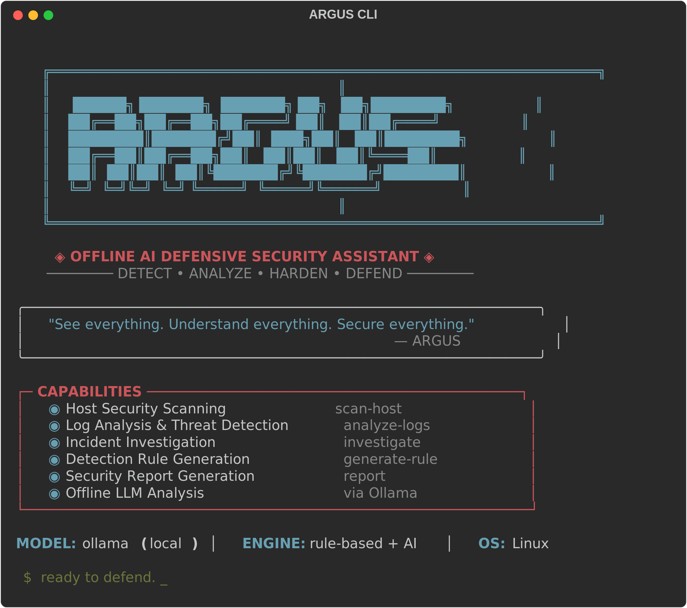

# ARGUS

### Offline AI Defensive Security Assistant

> **Local-first blue-team analysis for Linux.**

<p align="center">
  
</p>

<p align="center">
  <em>"See everything. Understand everything. Secure everything."</em>
</p>

---

## What is ARGUS?

**ARGUS** is an open-source, offline-first AI defensive security assistant for Linux systems. It is a Python-based CLI tool that helps **blue teams**, **SOC analysts**, **homelab users**, and **system administrators**:

- Analyze local security posture
- Investigate suspicious activity
- Generate defensive detection rules
- Produce clear remediation reports
- Map findings to MITRE ATT&CK

ARGUS is the **defensive counterpart** to offensive security tools. It focuses exclusively on defensive workflows: host hardening, log analysis, incident response, detection engineering, and risk prioritization.

> **Defensive only.** ARGUS does not provide exploit automation, credential attacks, reverse shells, payload generation, or any offensive capabilities.

---

## Features

| Feature | Command | Description |
|---------|---------|-------------|
| Host Security Scan | `argus scan-host` | Analyze SSH, users, sudo, ports, cron, systemd, firewall |
| Log Analysis | `argus analyze-logs` | Detect brute-force, spraying, suspicious logins |
| Incident Investigation | `argus investigate` | Guided triage for common incident types |
| Detection Rules | `argus generate-rule` | Generate Sigma, auditd, YARA, Suricata rules |
| Report Generation | `argus report` | Markdown and JSON security reports |
| Configuration | `argus config` | Manage ARGUS settings |

### Key Capabilities

- **Runs fully offline** — no cloud APIs, no telemetry, no API keys
- **Local LLM support** via [Ollama](https://ollama.ai/) for AI-powered analysis
- **Works without LLM** — rule-based findings are always available
- **MITRE ATT&CK mapping** for all findings
- **Beautiful CLI** using Rich tables, panels, and colored output
- **Multiple output formats** — Markdown and JSON reports

---

## Supported Platforms

| Platform | Status |
|----------|--------|
| Debian / Ubuntu | Primary |
| Kali Linux | Primary |
| Parrot OS | Primary |
| Other Debian-based | Supported |
| Fedora / Arch | Planned |
| macOS (read-only) | Planned |

---

## Installation

### Requirements

- Python 3.11+
- pip

### Install from source

```bash
git clone https://github.com/nodirumurkulov/Argus.git
cd Argus
pip install -e .
```

### Verify installation

```bash
argus --version
argus --help
```

---

## Quick Start

### Run a host security scan

```bash
argus scan-host
argus scan-host --output report.md
argus scan-host --format json --output findings.json
argus scan-host --no-llm
```

### Analyze authentication logs

```bash
argus analyze-logs /var/log/auth.log
argus analyze-logs /var/log/auth.log --severity high
argus analyze-logs /var/log/auth.log --output auth-report.md
```

### Investigate an incident

```bash
argus investigate --case ssh-compromise
argus investigate --case suspicious-user
argus investigate --case privilege-escalation
```

### Generate detection rules

```bash
argus generate-rule --type sigma --scenario ssh-bruteforce
argus generate-rule --type auditd --scenario suspicious-user-creation
argus generate-rule --type yara --scenario linux-webshell
```

### Generate a report

```bash
argus report --input findings.json --format markdown
argus report --input findings.json --format markdown --output report.md
argus report --input findings.json --format json
```

---

## Ollama Setup (Optional)

ARGUS uses local LLMs through [Ollama](https://ollama.ai/) for AI-powered analysis. This is **optional** — ARGUS works fully without it using rule-based analysis.

### Install Ollama

```bash
curl -fsSL https://ollama.ai/install.sh | sh
```

### Pull a model

```bash
ollama pull llama3.1:8b
```

### Configure ARGUS

```bash
argus config init
```

Default LLM configuration (`~/.config/argus/config.yaml`):

```yaml
llm:
  provider: ollama
  base_url: http://localhost:11434
  model: llama3.1:8b
  temperature: 0.2
  timeout: 120
  enabled: true
```

---

## Security Checks

### SSH
- Root login enabled
- Password authentication enabled
- Empty password login
- Weak ciphers configured
- Listening on all interfaces

### Users
- UID 0 users other than root
- Empty password fields
- Recently created users
- Service accounts with login shells

### Sudo
- Passwordless sudo
- Broad sudo access
- Writable sudoers include files

### Persistence
- Suspicious cron entries
- Unusual systemd services
- Writable systemd unit files
- Shell scripts in startup paths

### Network
- Unexpected listening services
- Services bound to 0.0.0.0
- Risky ports exposed

### Auth Logs
- SSH brute-force attempts
- Password spraying
- Successful login after repeated failures
- Sudo abuse
- Suspicious root login

---

## Severity Model

| Level | Description |
|-------|-------------|
| **CRITICAL** | Immediate action required |
| **HIGH** | Significant security risk |
| **MEDIUM** | Notable misconfiguration |
| **LOW** | Minor concern |
| **INFO** | Informational note |

---

## Project Structure

```
argus/
  argus/
    __init__.py          # Package info
    cli.py               # CLI commands (typer + rich)
    config.py            # Configuration management
    models.py            # Pydantic data models
    output.py            # Rich output and report writers
    collectors/          # Host data collectors
    analyzers/           # Security analyzers
    detections/          # Detection rule generators
    mitre/               # MITRE ATT&CK mapping
    templates/           # Report templates (Jinja2)
  tests/                 # Test suite
  examples/              # Sample data and reports
  docs/                  # Documentation assets
```

---

## Roadmap

### MVP (Current)
- [x] Python package with CLI
- [x] CLI with typer and Rich
- [x] Data models and configuration
- [x] Host security scanning
- [x] Authentication log analysis
- [x] Markdown and JSON reports
- [x] CLI option validation
- [x] GitHub Actions CI
- [ ] Ollama LLM integration
- [ ] Sigma rule generation
- [ ] auditd rule generation
- [x] MITRE ATT&CK mapping for core findings
- [x] Initial unit tests

### Future
- [ ] YARA rule generation
- [ ] Suricata rule generation
- [ ] TUI dashboard (textual)
- [ ] Wazuh integration
- [ ] OSQuery integration
- [ ] Zeek log support
- [ ] Docker image
- [ ] Web dashboard
- [ ] Multi-host collector
- [ ] Baseline drift detection

---

## Contributing

Contributions are welcome! Please:

1. Fork the repository
2. Create a feature branch (`git checkout -b feature/my-feature`)
3. Commit your changes (`git commit -m 'feat: add my feature'`)
4. Push to the branch (`git push origin feature/my-feature`)
5. Open a Pull Request

### Development Setup

```bash
git clone https://github.com/nodirumurkulov/Argus.git
cd Argus
pip install -e ".[dev]"
pytest
```

### Code Style

- Python 3.11+
- Type hints required
- Ruff for linting
- Conventional commits

---

## Defensive-Only Disclaimer

ARGUS is designed exclusively for **defensive security** purposes. It does **not** provide:

- Exploit execution
- Brute-force tooling
- Credential attacks
- Reverse shell generation
- Payload generation
- Vulnerability exploitation
- Automatic privilege escalation
- Persistence creation

ARGUS **does** provide:

- Defensive detection rules
- Hardening advice
- Incident response steps
- Forensic triage guidance
- Log analysis
- Local configuration review
- Read-only security posture checks

---

## License

MIT License — see [LICENSE](LICENSE) for details.

---

<p align="center">
  <strong>ARGUS</strong> — Local-first blue-team analysis for Linux.<br>
  <em>Detect • Analyze • Harden • Defend</em>
</p>
